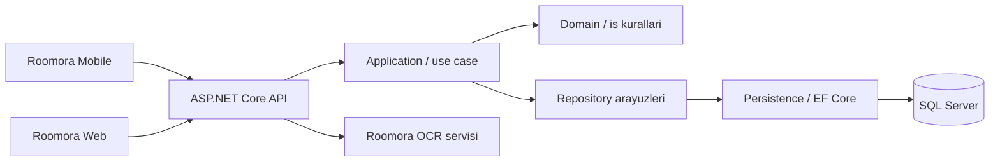
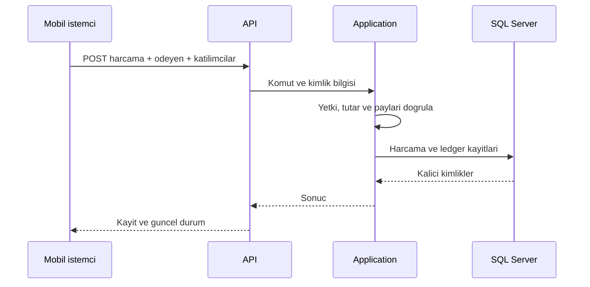

# Backend mimarisi

API katmani kimlik dogrulama, endpoint ve hata sozlesmesinden; Application katmani harcama/odeme akisi ve dogrulamadan; Domain modellerden; Persistence veri erisimi ve EF migration'larindan sorumludur. Core ortak altyapiyi tasir. Ev ve gezi gruplari ayni ledger'i kullanir; ev odakli planli faturalar geziye zorlanmaz.

Silme gerektiren finansal akislarda soft delete / iptal semantigi korunur. Yayinlanmis `Persistence/Migrations` dosyalari elle yeniden adlandirilmaz veya topluca silinmez. Dagitim ve geri alma ayrintilari `docs/DEPLOYMENT.md` icindedir.
